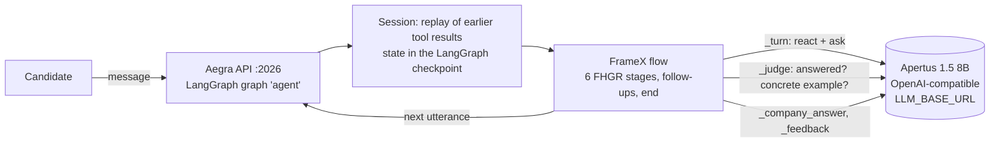

# PrepTalk — practise the apprenticeship interview before the real one

**Track 2A · FHGR: AI-Powered Job Interview Coach.** The coach runs a realistic apprenticeship interview in
German, French or Italian and then gives criteria-based, age-appropriate feedback. Apertus 1.5 8B does the
talking and the judging; a small rule engine, [FrameX](https://gitlab.com/ds-unisg/framex-core), decides what happens next.

Submission repository: [ghwiegand/PrepTalk](https://github.com/ghwiegand/PrepTalk) (currently private).

Team NLP-Lab: Götz-Henrik Wiegand (PhD student, University of St. Gallen). FrameX is pre-existing MIT-licensed
work from the Chair of Data Science and Natural Language Processing, University of St. Gallen, used as a dependency
(public repository [framex-core](https://gitlab.com/ds-unisg/framex-core), pinned commit `dee72c7`); see the
team, disclosure, and licence section of the [technical report](NLP-Lab_Report.pdf).



| Stage (FHGR flow) | What FrameX does | Model calls |
|---|---|---|
| Introduction | greeting as written, then «Erzähl uns etwas über dich» | – |
| Motivation, strengths & weaknesses, situational | 8–12 main questions (phone call: 3) from the FHGR question bank (by language and occupation); asks again once if the answer misses the question; asks for a concrete example when the judge finds none | per answer: 1 guard check + 1 reaction + 1 judgement (incl. the example check) |
| Candidate questions | answers as the company, from the posting's facts | 1 |
| Feedback | 11 FHGR criteria × 4 levels with evidence and one next step; a separate checklist for phone calls | 1 structured call, with a repair or rewrite if needed; phone feedback uses rules only |

## Reported evaluation

The original hackathon evaluation covered 28 simulated interviews on vLLM (Swiss AI image, one L4 GPU;
all six FHGR situations, de/fr/it; 14 scenarios held out during development). It reported all regression
checks met and **3.1 LLM calls per candidate answer** (limit: < 5).

With Gemini Flash playing the applicants, an independent judge (Claude Opus 5.5) found 72 % of the scenario
criteria met on the development scenarios and 56 % on the unseen ones (Gemini Pro: 80 % / 67 %;
Opus before the rules: 48 %). With harder simulated applicants (monosyllabic answers, digressions,
dialect, comprehension requests, distress), the reported Opus results were 59 % / 56 %, with all
regression checks met.

An evidence-driven alternative (`COACH_SEQUENCES=1`, off by default) was measured against the baseline
and not adopted: no gain beyond judge noise, twice as many unnecessary follow-ups. These are historical
results from the [technical report](NLP-Lab_Report.pdf); the original run files are not included.
The cleanup and rename do not rerun those experiments.

## Run it

```bash
cp .env.example .env
# Configure the Apertus endpoint in .env before starting.
make run          # Aegra API on http://localhost:2026 (PostgreSQL, Redis, coach); Apertus at LLM_BASE_URL
make run-gpu      # the same, plus Apertus 1.5 8B served by vLLM on a local NVIDIA GPU (~16 GB VRAM)
make chat         # talk to the running coach in the terminal
make stop         # stop the stack, retaining database volumes
```

`make run` copies `.env.example` to `.env` on first use. Set there:

| Variable | Meaning | Default |
|---|---|---|
| `LLM_NAME` | model name at the endpoint | `swiss-ai/Apertus-v1.5-8B` |
| `LLM_BASE_URL` | OpenAI-compatible base URL | `http://host.docker.internal:8000/v1` (Apertus on the host) |
| `LLM_API_KEY` | key, if the endpoint needs one | `none` |
| `HF_TOKEN` | only for `make run-gpu` (gated weights) | – |
| `PORT` | API port | `2026` |

The first Docker build needs internet access to fetch FrameX and the challenge data. The terminal
client requires only Python 3 and also accepts options through Make:

```bash
make chat ARGS="--lang it"
make chat ARGS="--scenario S-01 --trace trace.html"
make chat ARGS="--posting P-01 --lang fr --name Alex"
```

The terminal displays its welcome locally in the selected language (German by default).
It connects to the backend only after your first non-empty answer; pressing Enter immediately exits
without creating a thread. The greeting text is shared with the backend in `src/coach/greetings.py`.

Without a local GPU, point `LLM_BASE_URL` (and `LLM_API_KEY`) at a hosted endpoint running Swiss AI's vLLM image
(`ghcr.io/swiss-ai/vllm_apertus_1.5_release`, e.g. a Hugging Face Inference Endpoint on one L4 GPU, as in our
evaluation); `python -m eval.schema_check` checks a new endpoint before use.

The API is Aegra's (LangGraph Platform compatible): `POST /threads`, then
`POST /threads/{id}/runs/wait` with `{"assistant_id": "agent", "input": {"messages": [{"role": "user", "content": "..."}]}}`.
The first input may also carry `scenario_id`, `posting_id`, `candidate_id`, `lang` (`de`, `fr`, `it`), `name`,
`situation`, and `voice`;
without them the coach reads language, apprenticeship and first name from the first message (and from system
messages, e.g. a scenario description; ids like `S-04` or `P-11` in the text are recognised), and asks if the
apprenticeship is missing. «Gib mir jetzt Feedback» (or the French/Italian equivalent) ends the interview early with
feedback on what was said so far; at the end of every interview the state also holds a decision trace (`trace`). The [Agent Chat UI](https://github.com/langchain-ai/agent-chat-ui) works as a front end
(deployment URL `http://localhost:2026`, graph id `agent`).

`voice: true` renders feedback as text suitable for speech synthesis; audio input and output are not implemented.

The FHGR datasets are fetched at build time from github.com/fhgr/Hackapertus (pinned commit); they are licensed
for HackApertus use and therefore not committed here. Details: [technical report](NLP-Lab_Report.pdf).

## Code map

| Path | Responsibility |
| --- | --- |
| `src/main.py` | LangGraph state, setup, and conversation recovery |
| `src/coach/content.py` | Dataset loading, question plans, and FrameX flow generation |
| `src/coach/session.py` | Turn execution, replay, model calls, guards, and fallbacks |
| `src/coach/rules.py` | Deterministic checks on answers and company claims |
| `src/coach/feedback.py` | Feedback validation and text/spoken rendering |
| `src/coach/evidence.py` | Experimental evidence-based coaching |
| `src/coach/trace.py` | Decision trace rendering |
| `src/eval/` | Simulation, judges, regression checks, and comparisons |
| `docs/report/` | LaTeX sources for the technical report |
| `docs/challenge_docs/` | Local challenge reference documents (Git-ignored) |

Session state is JSON stored in LangGraph checkpoints. Each turn replays previous tool results
without model calls, then runs until another candidate answer is needed. Turns are serialized within
each process because FrameX's dialogue module uses shared globals.

## Development and checks

Docker uses Python 3.12; `.python-version` selects the same version for local uv environments.
Install Python dependencies with `uv sync --locked`. Local execution also needs the FHGR datasets
at `fhgr/datasets` (or an alternate `FHGR_DATA` path) and a FrameX binary built from the commit in
`Dockerfile`. Set `FRAMEX_BINARY` if the matching engine is not on `PATH`.

Install Ruff, then run `make check` for lint and Compose validation. These checks do not start
services or call a model. `make report` rebuilds the PDF with pdfLaTeX and the packages declared in
`docs/report/report.tex`, or with Tectonic, which fetches its TeX packages on the first build.
Regenerating the report figures additionally requires Matplotlib.

## Evaluation commands

Evaluation models are separate from the deployed coach. The simulator uses Gemini Flash by default
(`GOOGLE_API_KEY`); the default judge uses Anthropic (`ANTHROPIC_API_KEY`). Configure credentials in
`.env` before running:

```bash
make eval SCENARIOS="S-01 S-04 S-05"
docker compose exec coach python -m eval.rules_eval
docker compose exec coach python -m eval.protocol_test
docker compose exec coach python -m eval.schema_check
```

Local scripts need `PYTHONPATH=src` and model configuration exported in the shell; they do not load
`.env` themselves. Results go under `runs/` by default and are Git-ignored.

| Module | Purpose |
| --- | --- |
| `eval.simulate` | Simulate candidates in FHGR scenarios |
| `eval.judge` | Judge recorded interviews; `JUDGE_PROVIDER=google` selects Gemini Pro |
| `eval.regression` | Check recorded runs against hard requirements |
| `eval.feedback_eval` | Compare feedback with FHGR reference feedback |
| `eval.consistency` | Compare results across languages, situations, and profiles |
| `eval.protocol_test` | Exercise harness variants with a fake model |
| `eval.schema_check` | Check reply schemas on a new endpoint |
| `eval.ab_compare` | Compare baseline and pilot runs from `src/eval/ab_run.sh` |

For example: `PYTHONPATH=src uv run --locked python -m eval.regression runs/my-run`.

## Challenge and licence

The [FHGR challenge repository](https://github.com/fhgr/Hackapertus) contains the datasets, schemas,
and background material. Track 2A requires Apertus 1.5 8B, less than 32 GB VRAM, fewer than five model
calls per candidate answer on average, and a Docker-based submission with source code, documentation,
and a visual overview. Judging weights are performance (50 %), consistency (25 %), and innovation (25 %).

Project code is licensed under [Apache 2.0](LICENSE); FrameX is an external MIT dependency.
FHGR data is fetched separately and has its own licence. See the
[hackathon terms](https://hackapertus.ch/terms-and-conditions) for submission licensing requirements.
