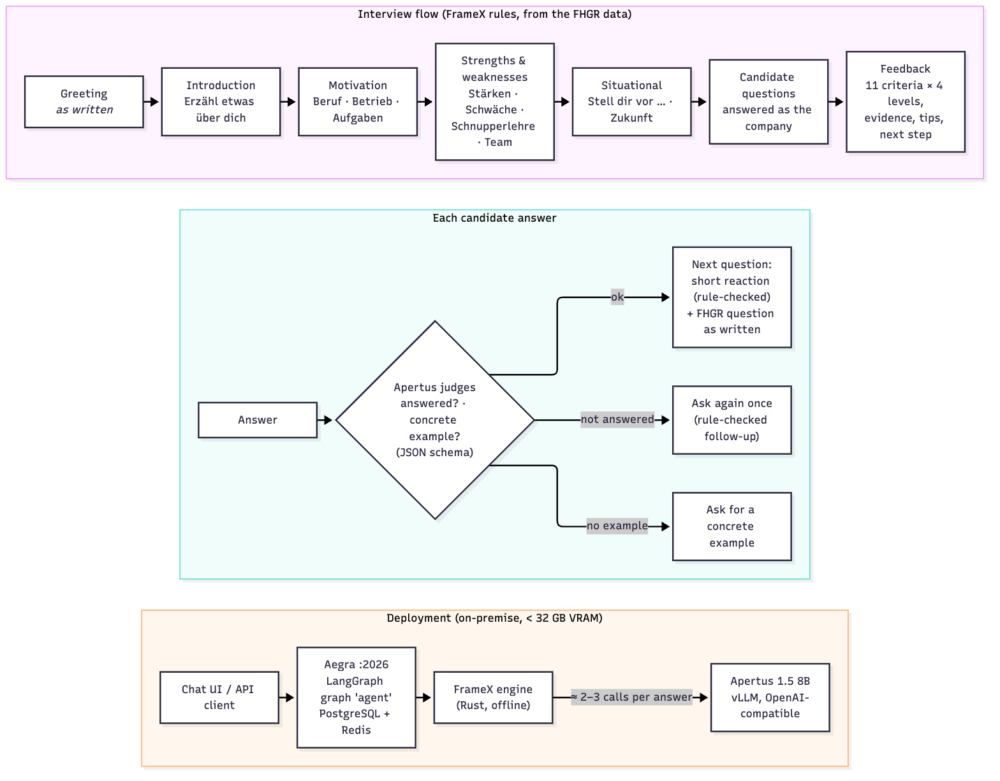

# Technical report — PrepTalk

- **Track:** Track 2A — FHGR: AI-Powered Job Interview Coach
- **Event:** Hack Apertus 2026, Online
- **Team:** NLP-Lab — Götz-Henrik Wiegand, PhD student, University of St. Gallen
- **Repository:** <https://github.com/ghwiegand/PrepTalk>
- **Demo:** Terminal client (`make chat`); video URL to be supplied separately with the submission.

## 1. Summary

PrepTalk lets teenagers practise an apprenticeship interview in German, French or Italian and receive
age-appropriate feedback. Apertus produces conversational reactions, evaluates candidate answers and
writes feedback. FrameX, a deterministic frame-logic engine, controls question order, follow-ups,
guard handling and the transition to feedback. Model output supplies observations; rules constrain
what the coach can say and which steps it can take.

The approach addresses a specific failure mode: a fluent interviewer can still skip a useful
follow-up, praise an unsupported claim or invent feedback evidence. PrepTalk keeps interview control
outside the language model and validates feedback against the actual conversation.

## 2. Architecture



The Docker stack contains the Aegra API, PostgreSQL checkpoints and Redis. An Apertus endpoint is
configured through `LLM_BASE_URL`. An optional Docker Compose profile starts Apertus with Swiss AI's
vLLM image on a local NVIDIA GPU.

The LangGraph graph `agent` accepts chat messages, derives or receives interview context, and calls
the interview session. Question plans combine the FHGR question bank, the selected situation,
occupation-specific questions and relevant profile conditions. The six supported situations are
an apprenticeship interview, online interview, first trial day, follow-up after a trial,
assessment and a telephone call requesting a trial apprenticeship.

FrameX chooses the next action. Each candidate turn replays stored tool receipts without repeating
model calls, consumes the pending answer, and runs until another candidate response is needed.
Session state is JSON stored by LangGraph. Calls within one process are serialized because the
FrameX dialogue adapter has shared globals.

The terminal client offers a localized main menu for scenario, posting and language selection,
followed by a static greeting before connecting to the backend. Neither step makes a model call. A
progress bar counts main questions from the actual flow; reasks and follow-ups retain their position.
The API also exposes progress metadata and a decision trace. The `voice` option formats feedback for
future speech synthesis; microphone input and audio playback are not implemented.

## 3. Use of Apertus

- **Model:** `swiss-ai/Apertus-v1.5-8B`
- **Use:** inference for setup extraction, conversational reactions, answer judgements, guard
  classification, company answers and final feedback; no fine-tuning or model adapters.
- **Serving:** OpenAI-compatible API. The evaluated deployment used Swiss AI's Apertus vLLM image
  on one NVIDIA L4. `make run-gpu` provides the local GPU alternative.
- **Configuration:** model temperature defaults to zero; model, endpoint, credentials and token
  limits are environment variables. Serving uses a 16,384-token context with the supplied GPU profile.

Typically an answer costs one guard check, one conversational reaction and one answer judgement.
The judgement includes the relevant follow-up check where possible. Rule-matched guards avoid
classification calls. Setup, candidate questions and feedback add their own calls. All live calls,
including retries, are counted. Model errors have deterministic fallbacks so that an unavailable
or malformed model response does not automatically terminate an interview.

The challenge's runtime gates are Apertus 1.5 8B, less than 32 GB VRAM and fewer than five model calls
per candidate answer on average. The reported evaluation measured about 3.1 calls per answer.

FrameX is pre-existing MIT-licensed work from the Chair of Data Science and Natural Language
Processing, University of St. Gallen. The dependency is pinned to
`fae782d15ab1fbc75dff066b176d38d2ae8fca35`. PrepTalk's interview flow, adapters, rules and evaluation
code are project-specific. The detailed report documents four extensions contributed to FrameX
during the hackathon.

## 4. Data

The project uses FHGR's supplied questions, annotations, rubric, scenarios, candidate profiles,
postings and background material. FHGR fictional profiles and postings provide interview context;
occupation information originates from berufsberatung.ch. The development scenarios are distinct
from the organizers' hidden benchmark.

The Docker build fetches a pinned FHGR dataset revision. Those materials are not committed here
because their licence is for HackApertus use. See [data provenance](data/README.md) for paths and
redistribution notes. Local reference PDFs and generated run files are Git-ignored. No new dataset
or collection of real candidate interviews is submitted.

## 5. Evaluation

The historical evaluation used 28 simulated interviews: 14 development scenarios and 14 held-out
scenarios covering all six situations and three languages. Gemini Flash simulated applicants.
Separate judges assessed scenario criteria: Claude Opus and, as a second perspective, Gemini Pro.
These evaluation models are separate from the deployed coach and are not runtime dependencies.

| Reported setup | Development criteria met | Held-out criteria met |
| --- | --- | --- |
| Before the rules, Opus judge (12 development scenarios) | 48% | Not measured in that comparison |
| Final coach, Opus judge | 72% | 56% |
| Final coach, Gemini Pro judge | 80% | 67% |
| Harder simulated applicants, Opus judge | 59% | 56% |

The reported final runs met the project's regression checks and averaged approximately 3.1 model
calls per candidate answer. A pilot with evidence-driven coaching sequences (`COACH_SEQUENCES=1`)
did not demonstrate an improvement beyond judge variation and increased unnecessary follow-ups;
it is off by default.

These are results reported by the original detailed evaluation, not new measurements of the
reorganized code. Original run files are not included, so the aggregate numbers cannot be
independently reconstructed from this checkout alone. The evaluation scripts are retained to
run new experiments with explicitly configured simulator and judge credentials.

Automated tests use deterministic local fixtures: CLI greeting/handoff checks, real FrameX flows
with mocked model adapters, and API protocol cases against a local fake model. They check software
behavior and do not establish real-model coaching quality. The protocol tests cover stateful and
stateless harnesses, incomplete setup, unknown IDs, language handling and early completion.

## 6. Limitations

- The 8B model can miss a contradiction or produce an unnecessary follow-up. Rules constrain
  behavior but do not replace semantic understanding.
- Historical held-out results are weaker than development results. Judge disagreement and
  synthetic applicants limit conclusions about real teenagers' experience.
- The reported L4 deployment had a median turn time of about 12 seconds and feedback generation
  of roughly 60–80 seconds. Current hardware and endpoint configuration affect latency.
- FrameX's shared dialogue globals serialize turns within a process. Scaling needs to account
  for that constraint and checkpoint storage.
- There is a terminal interface and API, but no custom browser frontend or voice interface.

## 7. Reproducibility

The submission project root is `track_2a/`. The repository-root Makefile forwards the same targets.
Judges can start from a clean checkout with Docker and Docker Compose:

```bash
cd track_2a
cp .env.example .env
# Set LLM_NAME, LLM_BASE_URL and LLM_API_KEY for an Apertus 1.5 8B endpoint.
make run
```

The first build needs network access to retrieve Python packages, FrameX and FHGR data. The
application API listens on port 2026. PostgreSQL and Redis start in Compose; required health checks
gate API startup. The model endpoint must be reachable from the coach container. No credentials
are committed.

With a compatible NVIDIA GPU and access to the Apertus weights, `make run-gpu` starts the model
as well. The bf16 weights need about 16 GB VRAM; model context and serving overhead also consume
memory, so the complete configuration must remain within the challenge's 32 GB limit.

For a manual interview, run `make chat` in another terminal. Use `ARGS="--lang fr"` or
`ARGS="--lang it"` to select a language, and `ARGS="--scenario S-01 --trace trace.html"` for a
scenario with an exported decision trace.

`make check` runs lint and Compose validation. After building the coach image, `make test-docker`
runs automated tests without an external model. `make test-unit` needs only Python 3 on the host.
Local Python tooling uses Python 3.12 and `uv sync --locked` in this directory.

See [evaluation commands](README.md#evaluation-commands) for new simulation and judge runs. The
source checkout/commit, model endpoint configuration and run files should be retained for each new
experiment. Docker pins the FrameX and FHGR source revisions, and `uv.lock` pins Python dependencies.

## 8. Next steps

Evaluate with real users and qualified educators, improve the quality of follow-ups on difficult
answers, reduce latency, and retain reproducible run artifacts with future results. Evidence-based
coaching should remain experimental until extraction reliability and user benefit are demonstrated.

## Team, disclosure and licence

FrameX is pre-existing university work, disclosed as a dependency above. Siegfried Handschuh is a
member of the HackApertus jury; the detailed report records that this participation was announced
and that he recuses himself from judging this submission. Development used AI coding assistants.

Project code is [Apache 2.0](../LICENSE); FrameX remains MIT. Project-authored documentation and this
report are licensed under [Creative Commons Attribution 4.0](https://creativecommons.org/licenses/by/4.0/).
Third-party material retains its original licence.

## References

- [FHGR challenge and datasets](https://github.com/fhgr/Hackapertus)
- [Hack Apertus submission template](https://github.com/HackApertus/project-template)
- [Apertus 1.5 8B](https://huggingface.co/swiss-ai/Apertus-v1.5-8B)
- [FrameX](https://gitlab.com/ds-unisg/framex-core)
- [LangGraph](https://github.com/langchain-ai/langgraph) and [vLLM](https://github.com/vllm-project/vllm); Aegra and Python dependency versions are recorded in [uv.lock](uv.lock).
- Detailed report sources: [docs/report/report.tex](docs/report/report.tex)
